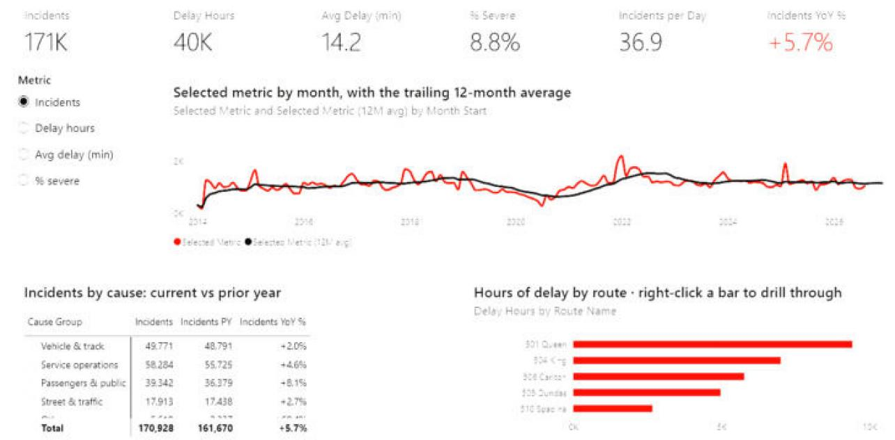

# TTC Streetcar Delays — Power BI report

Where, when and why Toronto's streetcars run late: **170,928 delay incidents** from January 2014
to August 2026, from City of Toronto Open Data.

Built in Power BI Desktop and saved as a **Power BI Project (.pbip)**, so the model (TMDL) and the
report (PBIR) are readable text and version-controlled.

## Report pages

| Page | What it shows |
|---|---|
| **Overview** | KPI cards (incidents, delay hours, average delay, % severe, incidents per day, YoY %), a metric selector driving a monthly trend with a 12-month average, incidents by cause vs. prior year, hours of delay by route |
| **Routes** | Hours of delay by route and year (heat map), frequency vs. severity scatter, % severe by route with an adjustable "severe" threshold, incidents by delay length |
| **When** | Weekday × hour heat map, incidents and average delay by service period, seasonality by month |
| **Causes** | Decomposition tree of delay hours, cause mix by year, incident detail table |
| **Map** | Delay locations sized by incidents, top 15 locations, share of incidents that could be mapped |
| **Route detail** | Drill-through page: right-click a route anywhere → *Drill through → Route detail* |
| **Route tooltip** | Report-page tooltip shown when hovering a route (hidden page) |

The four header slicers (Year, Service, Route, Cause group) are synced across pages.

## Data model

- **Star schema:** one fact table (`Delays`) and dimensions `Date`, `Time of Day`, `Route`, `Cause`, `Location`.
- **29 DAX measures** in display folders, including like-for-like year-to-date comparisons
  (2026 only has data to August), a selectable metric with a **dynamic format string**, a
  **what-if style severity threshold**, route ranking and top-15 logic.
- A **calculation group** (`Time Comparison`: Current, Prior Year, YoY Change, YoY %).
- Power Query loads the CSVs through a `DataFolder` parameter and adds a delay-length band.

## Open it

1. Install **Power BI Desktop** (Windows).
2. Clone or download this repository.
3. Double-click **`TTC Streetcar Delays.pbip`**.
4. The data cache isn't stored in git, so point the model at the CSVs:
   **Home → Transform data → Edit parameters → DataFolder** = the full path of this repo's
   `data` folder (for example `C:\Users\you\ttc-streetcar-delays-powerbi\data`), then **Apply changes / Refresh**.
5. If maps are blank: **File → Options and settings → Options → Security → Map and Filled Map visuals**.

## Data notes

- Source: City of Toronto Open Data — TTC Streetcar Delay Data (2014 – Aug 2026).
- The yearly raw files were cleaned and combined before loading (unified column names, route
  numbers, cause categories); `data/` holds the cleaned CSVs the report reads.
- From 2025 the TTC switched to detailed delay codes. Codes without a published meaning are
  grouped by their first letter, which is **an analyst assumption**, so compare cause trends
  across 2024 → 2025 with care.
- Locations are placed on the map by matching their names to TTC stops; free-text locations
  that couldn't be matched aren't mapped.
